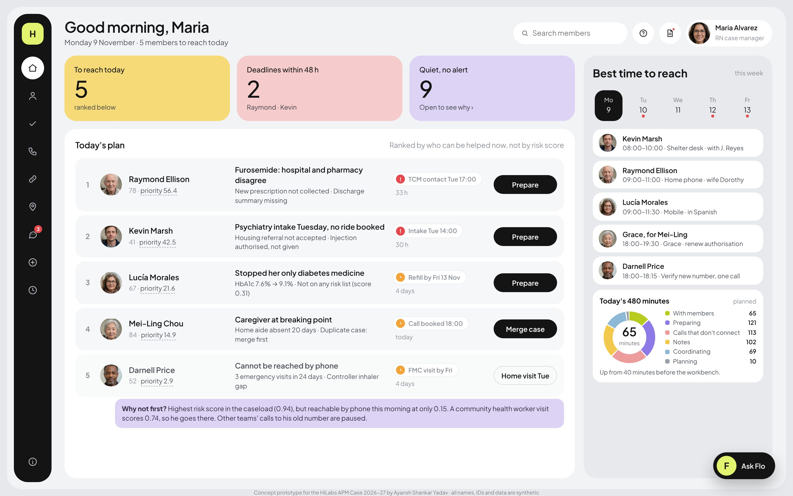
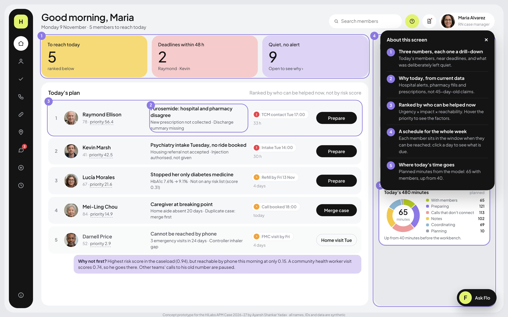
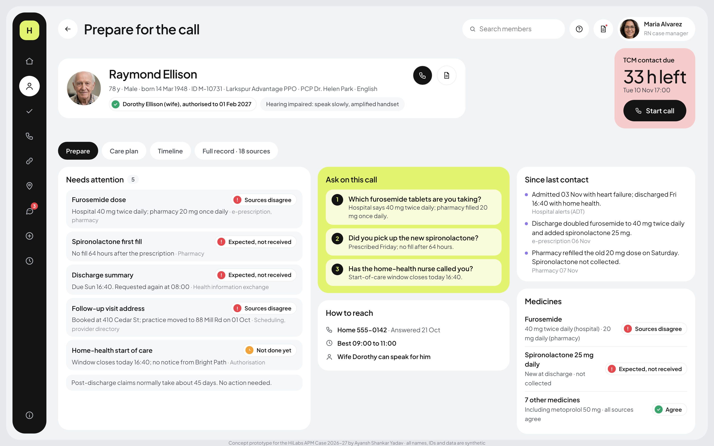
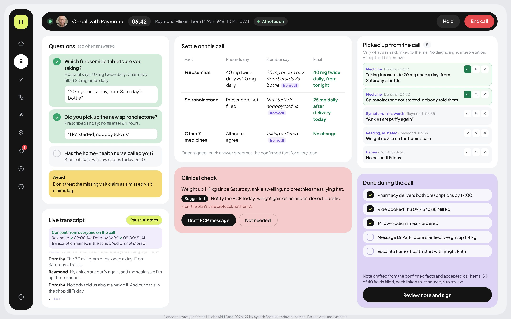
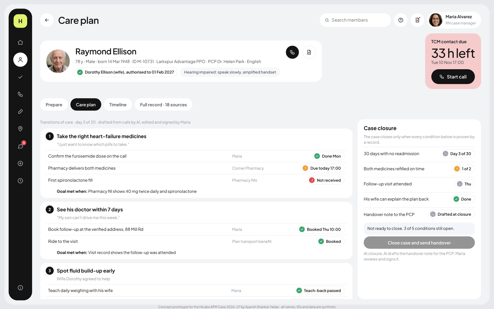
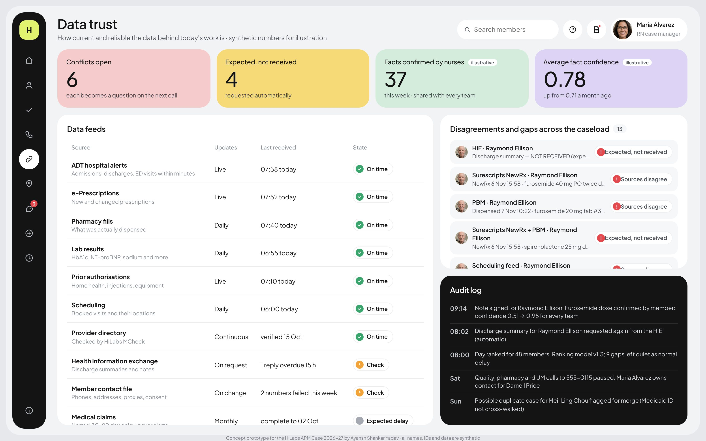
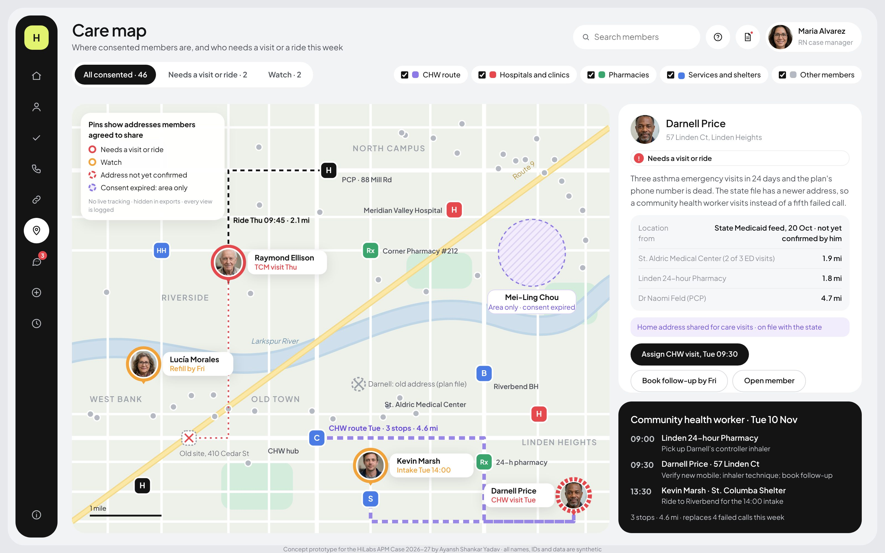
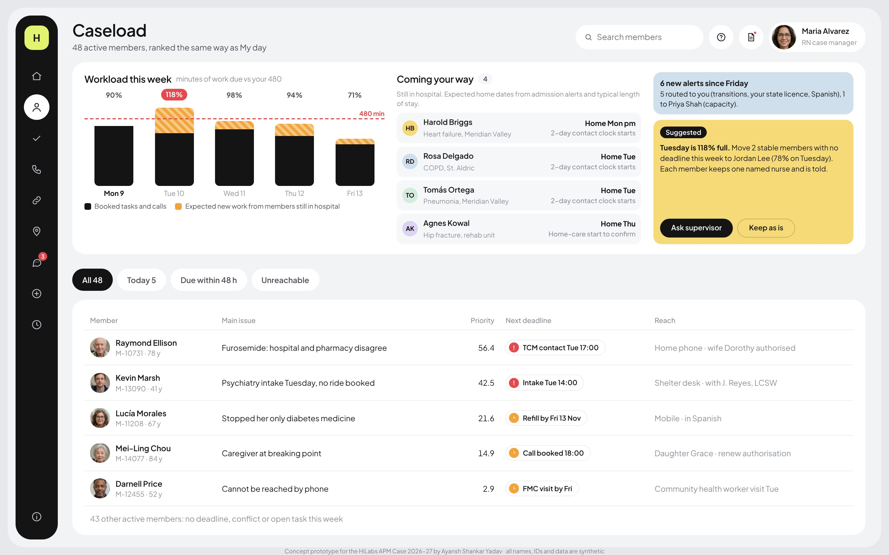

# Care Workbench

A workbench for nurse case managers that shows where every fact came from, and who can be helped today.

**[Open the live prototype](https://ayanshs007.github.io/care-workbench/)**

Works best on a laptop. It is a single clickable page with no sign-in.

## The problem in one paragraph

Maria is an RN case manager at a Medicare Advantage plan. She looks after 48 members, yet she has only 2 real conversations with them on a typical day. The rest of her time goes to piecing together data that arrives late and disagrees with itself, calls that do not connect, and writing notes. Care Workbench is a concept for giving that time back.

## What the workbench does

- **Trust.** Every fact shows its source, its age and whether the sources agree. A disagreement is never hidden. It becomes a question to ask on the call.
- **Focus.** The day is ranked by who can be helped now, not by risk score. The screen explains why a high-risk member is not first when they cannot be reached this morning.
- **Flow.** Maria prepares the call. During the call, AI picks up facts with everyone's consent. Maria reviews and signs the note. Tasks and case closure rest on evidence from records, not on someone ticking a box.

AI prepares and drafts. The nurse decides and signs.

## A 3-minute tour

The tour follows one member, Raymond Ellison, a 78 year old man home after a heart failure admission.

**1. My day.** Raymond is first because his hospital and pharmacy records disagree on his furosemide dose and a deadline is 33 hours away. Hover over a priority number to see its factors. Click the **?** button in the header (or press **E**) to show numbered notes explaining the screen. Then click **Prepare** on Raymond's row.

**2. Prepare for the call.** "Needs attention" lists what is wrong, each item marked "Sources disagree" or "Expected, not received". The same gaps become three questions under "Ask on this call". Medicines show which source says what. Click **Start call**.

**3. Call mode.** The call opens with consent from everyone on the line. "Settle on this call" puts what the records say next to what the member says. "Picked up from the call" holds only what was said, and each line can be accepted, edited or removed. Click **Review note and sign**, check the note, then click **Sign and file**.

**4. Care plan and case closure.** Go back to Raymond's page and click the **Care plan** tab. Each goal has steps with an owner and a "Goal met when" line that names the record that proves it. The Case closure panel stays locked until every condition is proven.

**5. Data trust.** Click the link icon in the left rail. It shows each data feed and whether it is on time, the disagreements across the caseload, and an audit log of what changed and when.

## Other screens

<table>
  <tr>
    <td width="50%"></td>
    <td width="50%"></td>
  </tr>
  <tr>
    <td><b>Care map.</b> Where consented members are, who needs a visit or a ride, and a route for the community health worker.</td>
    <td><b>Caseload.</b> All 48 members ranked the same way as My day, with the week's workload against 480 minutes a day.</td>
  </tr>
</table>

Open tasks, Team contacts and Pilot report are also in the left rail.

## Built-in safeguards

- AI listens only after everyone on the call agrees, and no audio is stored.
- AI extracts only what was said and never diagnoses.
- Nothing is sent or signed without the nurse.
- Addiction-treatment records stay locked without consent.
- Addresses are shown only with consent.

## Headline numbers

| Measure | Value |
|---|---|
| Real conversations per nurse a day | 2 to 3.2 |
| Time back per nurse | about 172 minutes a day |
| Loaded minutes per conversation | 215 to 139 |
| Pilot design | 90 days, 10 RNs against a 10-RN control group |

These come from a time model in the case deck.

## How to run locally

Download `index.html` and open it in any browser. There is nothing to install, no build step and no server. The page makes no outside requests.

To re-make the screenshots, run `python docs/take_screenshots.py` (needs Python, Playwright and Pillow).

---

Concept prototype for the HiLabs APM Case 2026-27 by Ayansh Shankar Yadav. All names, IDs and data are synthetic. Not a HiLabs product.
